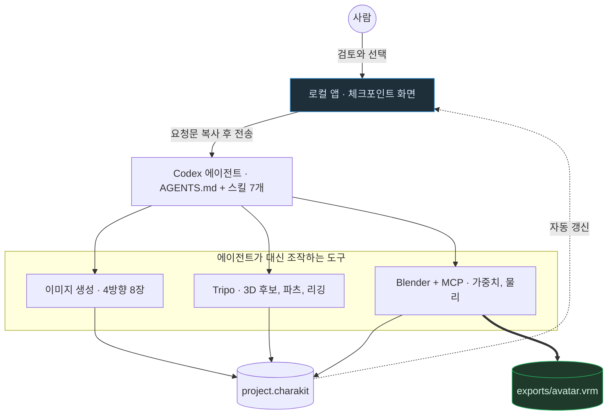

# Charakuru — 사람과 에이전트는 어디서 일을 주고받나

> `Charakuru.md`의 별첨 플로우차트. 작성 규칙은
> `DevelopPrompt/Unity/VISUALIZE_RULE/04_MERMAID_STYLE.md`를 따른다.
> 기준 시점: 2026-10-13, Charakuru 1.0.2 배포 문서 기준

**읽는 법**: 위에서 아래로 한 바퀴가 체크포인트 하나다. 사람은 `APP`에서 결과를 보고 고른 뒤,
앱이 만든 요청문을 채팅으로 `AG`에게 넘긴다. 에이전트는 단계에 맞는 도구(`IMG`, `TRIPO`, `BL`)를
조작하고 결과를 `KIT`에 기록한다. 앱이 그 변화를 읽어 다음 체크포인트 화면으로 바뀌면(점선) 다시
사람 차례다. 이 바퀴가 다섯 번 돌면 마지막에 `BL`이 `avatar.vrm`을 내보낸다(굵은 화살표).

**핵심**: 사람과 에이전트는 서로 직접 연결되지 않는다. 둘 사이에는 항상 `APP`(판단하는 자리)과
`KIT`(기록하는 자리)이 끼어 있어서, 에이전트가 사람 몰래 다음 단계로 넘어갈 길이 구조적으로 없다.
